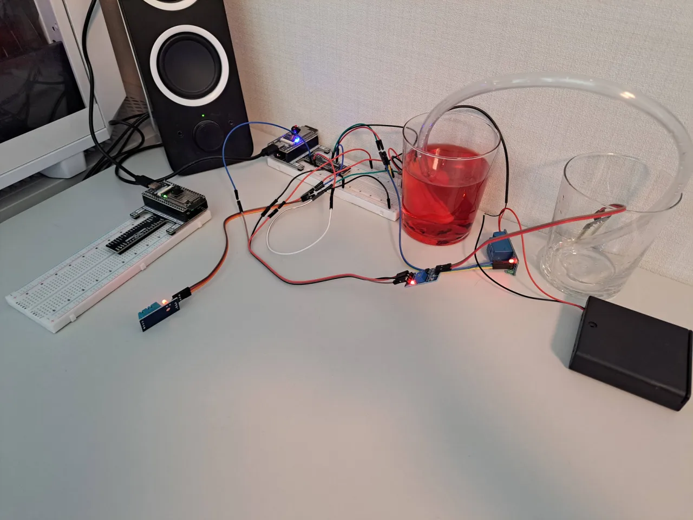
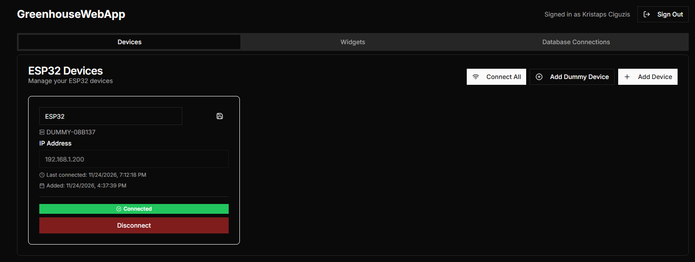
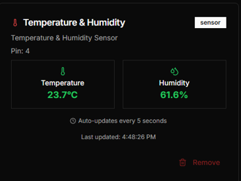
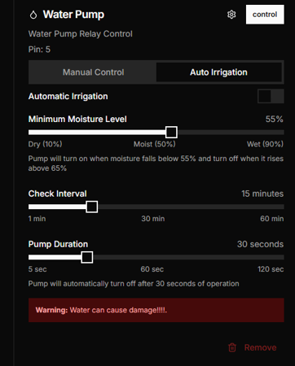

# SmartGreenhouse

A web app for managing and monitoring a greenhouse built around ESP32 devices. Connect your devices, add widgets for sensors and relays, and watch live readings or control things like irrigation from the browser.




## Features

- **Authentication:** sign in / sign out per user
- **ESP32 device management:** add devices (or dummy devices for testing), set the IP address, connect / disconnect, "Connect All"
- **Widgets:** sensor and control widgets configured per device and pin
  - **Temperature & Humidity:** live readings, auto-updates every 5 seconds
  - **Water Pump (relay):** manual control or automatic irrigation
- **Automatic irrigation:** configurable minimum moisture level, check interval and pump duration
- **Database connections** tab for managing the data source <!-- EDIT: say what this does in one line -->

## Widgets

| Temperature & Humidity | Water Pump |
| --- | --- |
|  |  |

The temperature widget reads a sensor on pin 4 and refreshes every 5 seconds. The pump widget controls a relay on pin 5. In auto mode it turns the pump on when soil moisture drops below the chosen level and switches it off again after the set duration.

## In real life


<!-- EDIT: one line on the hardware, e.g. which sensor you use (DHT22?), moisture sensor, relay module, power -->

## Tech stack

- **Frontend:** Next.js (App Router), TypeScript, Tailwind CSS, shadcn/ui
- **Backend / database:** Supabase
- **Hardware:** ESP32 <!-- EDIT: sensors, relay module -->
- **Hosting:** <!-- EDIT: Vercel? -->

## How it works

<!-- EDIT: short data flow in your own words, for example: -->
```
ESP32 (sensors + relay) <--> Next.js web app <--> Supabase
```

## Project structure

```
app/          Pages and routes
components/   UI components and widgets
hooks/        Custom React hooks
lib/          Helpers and Supabase client
supabase/     Database schema / migrations
types/        TypeScript types
doc/          Screenshots and GIFs for this README
```

## Getting started

```bash
git clone https://github.com/KristapsCiguzis/SmartGreenhouse.git
cd SmartGreenhouse
npm install
cp example.env.local.md .env.local
npm run dev
```

Open http://localhost:3000.

### Environment variables

Copy [`example.env.local.md`](example.env.local.md) to `.env.local` and fill in your own values.


No hardware? Use **Add Dummy Device** on the Devices tab to try the app with simulated data.
